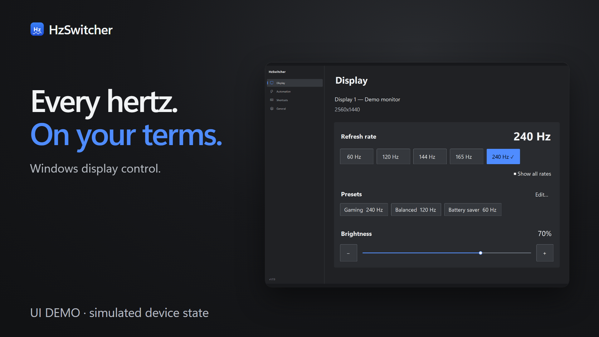

# HzSwitcher

A small Windows tray app for switching a monitor's refresh rate and brightness, with an automatic power-saver that drops the rate when you are idle or watching video.

Version 1.8.0. Windows 10 or 11, x64. Built with C# on .NET 10 (Windows Forms). The release exe is self-contained, so no .NET install is needed.

[](docs/HzSwitcher-Trailer-55s.mp4)

Watch the 55-second teaser (click the poster; GitHub opens the MP4 in its player). Product scenes use simulated device state, not a real monitor. Download the installer from `artifacts/installer/HzSwitcher-Setup-1.8.0.exe` (SHA-256 beside it). It is unsigned, so SmartScreen may warn.

## What it does

- **Refresh rate:** one-click switching from the tray menu or the main window. The tray icon shows the current rate. Rates below 60 Hz and near-duplicates such as 59 or 119 are hidden unless "Show all rates" is on.
- **Presets:** named one-click rates. Defaults are Gaming (highest), Balanced (120 Hz) and Battery saver (60 Hz). If the monitor doesn't support a rate, the nearest one is used.
- **Auto power-saver:** after the configured idle time, or after video has been playing with no input, it drops to the saver rate. Your previous rate returns after a stretch of continuous activity. It never throttles while a game from the game list is in front, and it pauses while the screen is locked.
- **App profiles:** pick a refresh rate for specific apps. It applies while the app is in front and goes back after the app has been out of focus for a few seconds. Changing the rate yourself overrides the profile.
- **Pause automation:** pause saver and app profiles together for 15 minutes, 1 hour, or until restart. Manual controls remain available, and saved enable switches stay unchanged.
- **Diagnostics:** inspect display, brightness, automation, and recent failures from General > Maintenance or the tray menu. Copy a sanitized local report without logs, profile names, or monitor identifiers.
- **Brightness:** a slider in the tray menu and on the Display page. Each monitor remembers its own level, and the power-saver can lower brightness too (see below).
- **Hotkeys:** global shortcuts. Defaults: Ctrl+Alt+1, 2 and 3 apply the presets, Ctrl+Alt+0 toggles the auto power-saver.
- **Multiple monitors:** choose which monitor is controlled.
- **Safety net:** rate changes are checked, and if the display ends up at an unexpected rate it is put back on the fallback rate (240 Hz by default, or the highest supported). If the app dies in the middle of a change, the fallback is applied at the next start.

## Brightness

HzSwitcher tries three methods, in this order:

1. **DDC/CI** (external monitors). Real backlight control. The monitor must have DDC/CI turned on in its own on-screen menu. Some monitors, docks and cables don't support it.
2. **WMI** (laptop built-in panel).
3. **Software dimming** (any monitor). Only darkens the picture; it does not change the backlight, cannot go brighter than the monitor's own setting, and is limited to 20% at the low end. It can conflict with Night light or HDR. The app labels this mode so you can tell.

Settings related to brightness:

- *Saver brightness* (Automation page): level used while the power-saver is active, or "Unchanged". Your own level comes back when the saver ends. If you change brightness during the saver, that new level is the one restored. If the app is closed or crashes mid-saver, the old level is restored at the next start.
- *Restore each monitor's brightness at startup* (General page): off by default. The app never changes brightness at startup unless you turn this on.

## Using it

- Left-click the tray icon to open the window, right-click for the menu. Closing the window keeps the app running in the tray; use **Exit app** (General page or tray menu) to quit.
- The window has four pages: **Display** (monitor, rate, presets, brightness), **Automation** (power-saver, app profiles, detection settings), **Shortcuts** (actions and key combinations) and **General** (notifications, startup, always on top, maintenance, exit).
- Display marks the monitor's current refresh rate with a check. Presets are one-click actions; multiple presets can resolve to the same rate.
- The window is dark, uses your Windows accent colour, and has a fixed default size that scales with display DPI. Oversized windows and dialogs fit the monitor's working area, with scrolling for their content. Windows high-contrast changes apply to open windows.

Use **Automation > Pause…** or the tray's **Pause automation** submenu. Pausing first restores automation-owned rate and brightness state, respecting manual choices and monitor changes. If restoration fails, automation stays paused and **Retry restore** is available. Resume starts idle/video qualification and profile debounce afresh, respecting cooldown and lock suspension. Pauses are cleared when the app restarts.

**Diagnostics…** shows the exact report copied by **Copy diagnostics**, with monitor/profile names in a separate local-only area. Brightness levels distinguish requested values from hardware reads. Opening the dialog uses cached brightness information; **Refresh** reads hardware in the background without applying a rate or brightness change. No report is uploaded.

## Always on top

On **General**, turn on **Always on top**, then focus another app and press **Ctrl+Alt+T** to pin or unpin its window above ordinary windows. Open **Configure… > Edit shortcuts…** to edit the shortcut. The feature is off by default and needs HzSwitcher running; hiding to the tray keeps it active. The status shows whether the shortcut is available.

Pinned windows show an outline in the Windows accent color and play distinct short sounds when pinned or unpinned. **General > Always on top > Configure…** lets you switch the outline, sounds and mouse gesture on/off, and choose outline thickness (1-8 logical pixels, scaled for the monitor). Save applies preference edits; Cancel discards them. Unpin all takes effect immediately.

**Right-click a standard title bar or window frame** to open a window menu with a checked **Always on top** option alongside the app's window commands (Restore, Move, Size, Minimize, Maximize and Close where available). Choose Always on top again to unpin. The **Original window menu** entry closes the HzSwitcher popup and opens the application's native Alt+Space menu, including specialized or owner-drawn commands.

**Shift+right-click** anywhere on a window opens the compact HzSwitcher menu, including for custom title bars that are drawn inside the app's content. A normal **right-click on the pinned outline** opens the same compact menu. General's mouse-menu setting controls frame and Shift+right-click gestures. Actions use the clicked window even if another window has focus. Ordinary right-click inside app content continues to use that app's context menu. Frame integration uses a HzSwitcher popup populated from the system menu; it does not permanently modify another app's menu.

Mouse pin menus and outlines pause while a fullscreen app or a game in the configured game-process list is foreground. This includes Shift+right-click and applies across monitors. Normal menus and outlines return after leaving fullscreen or switching to a desktop app. Pins stay in place; the keyboard shortcut and General > Unpin all remain available.

You can pin several windows. **Unpin all**, turning the feature off, or **Exit app** restores windows pinned by HzSwitcher. Windows already on top are left unchanged. Some protected or elevated windows cannot be controlled, and other topmost windows or exclusive fullscreen apps can cover a pinned window.

Cleanup is best effort. If HzSwitcher crashes or is force-closed, a pinned app may stay on top; close and reopen that app to recover. Pinned windows are not restored across restarts. If the shortcut conflicts with PowerToys or another app, choose another combination. Successful pin/unpin actions use the outline and optional sound without a notification popup. Errors and explanations (such as a window already pinned outside HzSwitcher) still display feedback.

## Files and settings

Everything is stored per user in `%APPDATA%\HzSwitcher`:

| File | Purpose |
| --- | --- |
| `settings.json` | All settings. Edit it only while the app is closed. A file that can't be read is kept as `settings.json.bad` and defaults are used. |
| `log.txt` | Plain-text log of switches, monitor detection and errors. Truncated after about 512 KB. |

"Start with Windows" adds a per-user entry under `HKCU\Software\Microsoft\Windows\CurrentVersion\Run`; turning it off removes it.

## Building

Requires the .NET 10 SDK.

```powershell
# debug build
dotnet build -c Debug -o $env:TEMP\hzbuild

# tests
dotnet test tests\HzSwitcher.Tests

# self-contained single-file release
dotnet publish -c Release -r win-x64 --self-contained true `
  -p:PublishSingleFile=true -p:IncludeNativeLibrariesForSelfExtract=true `
  -p:EnableCompressionInSingleFile=true -o artifacts\1.7.3
```

The installer is built with [Inno Setup 6](https://jrsoftware.org/isinfo.php) from the published exe:

```powershell
& "$env:LOCALAPPDATA\Programs\Inno Setup 6\ISCC.exe" /DAppVersion=1.8.0 artifacts\installer\HzSwitcher.iss
```

It writes `artifacts\installer\HzSwitcher-Setup-<version>.exe`. The installer is unsigned, so Windows SmartScreen may warn about it.

## Project layout

| Folder | Contents |
| --- | --- |
| `Native/` | Windows API declarations (display modes, DDC/CI and gamma, input, shell) |
| `Services/` | Display, brightness, auto power-saver, profiles, safety net, settings, logging |
| `UI/` | Main window, dialogs, theme, tray menu renderer |
| `UI/Controls/` | Custom dark controls (cards, pill buttons, toggle, slider, number box, nav rail) |
| `tests/HzSwitcher.Tests/` | xUnit tests for the logic and the simple controls |

More background: `IMPLEMENTATION_PLAN.md` (earlier improvement plan), `FLICKER_REDUCTION.md`, `BRIGHTNESS_IMPLEMENTATION.md`, `UI_REVAMP_IMPLEMENTATION.md` (design notes for the 1.4.0 and 1.5.0 work), and `UI_REDESIGN_IMPLEMENTATION.md` (the current UI redesign and verification record).

## Known limits

- Brightness over DDC/CI can be slow on some monitors (tens to hundreds of milliseconds per change); the app applies only the newest requested value while you drag.
- The refresh-rate list comes from the monitor's current resolution, so it can differ after a resolution change.
- The installer and exe are not code-signed.
